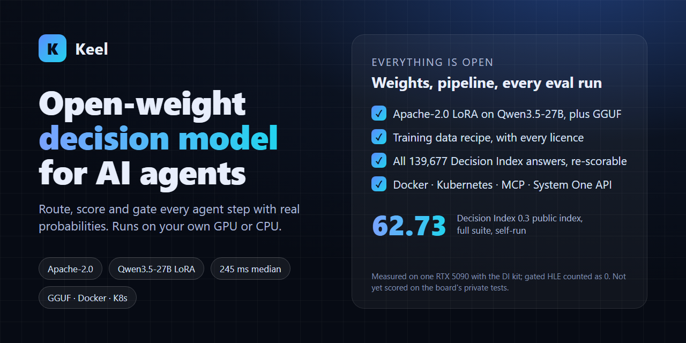

# Keel

**Fast, typed decisions for agents and apps, computed on your own machine.**

[](https://github.com/sivamatic/Keel/actions/workflows/ci.yml)
[](LICENSE)
[](artifacts/parity/pro/di-results.md)
[](https://huggingface.co/neerumsr/keel-pro)



> **New: Keel-Pro.** An open-weight Qwen3.5-27B LoRA that scores **62.73** on the full Decision Index 0.3 public
> suite (139,677 requests, self-run with the DI kit). Median latency 245 ms on one RTX 5090.
> For scale: the live DI board (0.4.1, 346 entries) ranks on private tests we have not been run on yet; on the public
> index alone 62.73 would sit around #99, and the best entries score 73–75. [Story](docs/keel-pro.md) · [Model card](artifacts/parity/pro/MODEL_CARD.md) · [Deploy](docs/deployment.md)

Keel is a small open-weight decision model. You send it some text and a typed question (pick one option, rate on a scale, or yes/no). It returns calibrated probabilities in milliseconds, with no network call, no account and no per-token bill. It speaks the same System One wire as TypeSafe Jev and Microsoft-Decision-1, so existing clients work after a base-URL change.

```text
state + question  ──►  Keel (local, ~15 ms)  ──►  {"choice":"billing","confidence":0.92,"probabilities":{…}}
```

[Quickstart](docs/quickstart.md) · [Concepts](docs/concepts.md) · [API reference](docs/api-reference.md) · [Integrations](docs/integrations.md) · [Deploy](docs/deployment.md) · [Token savings](docs/token-savings.md) · [Benchmarks](docs/benchmarks.md) · [Model card](docs/model-card.md) · [All docs](docs/index.md)

## Why Keel

| | |
|---|---|
| **Local and offline** | The model runs in-process on CPU through ONNX Runtime. The text you send never leaves the machine. |
| **Free to run** | No API key, no account and no per-token price. The only cost is a few milliseconds of your own CPU. |
| **Small** | <!-- num:k3.size -->17.7 MB<!-- /num --> (Keel-3, mixed int8) or <!-- num:k2.size -->13 MB<!-- /num --> (Keel-2). It fits in a repository, a container layer or a laptop. |
| **Fast** | In-process p95 of <!-- num:k3.p95.idle -->13.7–14.3 ms<!-- /num --> for Keel-3 on an idle CPU, against <!-- num:k2.p95.idle -->13.3–14.5 ms<!-- /num --> for Keel-2. There is no network round trip. |
| **Drop-in wire** | `POST /api/v1/systemone` with `state`, `questions`, and the `choice`, `score` and `noul` types. Jev SDKs work with a base-URL change. Microsoft-Decision-1 clients work through the `/providers/microsoft/v1/systemone` path and the `api-key` header. |
| **Open weights** | Apache-2.0 code and weights, fine-tuned from MIT-licensed bases. You can retrain it on your own decision families. |
| **Built for "Keel first, LLM fallback"** | Keel answers the confident cases. Low-confidence questions go to your LLM. This is where the token savings come from. |

## The headline: fewer LLM tokens

When an agent sends each typed decision to a dedicated LLM call, putting Keel in front of that call at confidence gate **τ = 0.6** cut LLM tokens by **<!-- num:tok.k3.ho.cut -->75.8%<!-- /num -->** on our held-out suites. On those suites, accuracy also rose from <!-- num:tok.k3.ho.acc -->75 → 89 of 100 cases fully right<!-- /num -->, and Keel avoided <!-- num:tok.k3.ho.avoided -->75/100<!-- /num --> LLM calls.

On the harder 234-case **blind** suite, the same gate gave <!-- num:tok.k3.blind.cut -->44.9%<!-- /num --> fewer tokens. There, accuracy fell slightly, <!-- num:tok.k3.blind.acc -->64/71 → 63/71 (−1.4 pts)<!-- /num --> on the cases with an LLM answer, and safety misses went <!-- num:tok.k3.blind.safety -->0 → 1<!-- /num -->.

These figures were measured with `t1-r2e`, a Keel-3 release candidate. The promoted Keel-3 (`t1-r11`) has not been re-measured for tokens yet; on accuracy it matches or beats `t1-r2e` on every suite except blind-c (see [Benchmarks](docs/benchmarks.md)). Keel-2 saves <!-- num:tok.k2.ho.cut -->60.6%<!-- /num --> on held-out, but costs <!-- num:tok.k2.ho.accdelta -->6<!-- /num --> points of accuracy.

There is one case where Keel does **not** save tokens: a frontier agent that already holds the text and answers in about 20 tokens. In that case the tool-call overhead is larger than the saving. See [when Keel does not save tokens](docs/token-savings.md#when-keel-does-not-save-tokens).

## 60-second quickstart

You need Node 22 or later.

```powershell
git clone https://github.com/sivamatic/Keel.git; cd Keel
npm install
npm run dev                                   # serves http://127.0.0.1:8080 (npm run build && npm start for a standalone server)
```

In a second terminal, get your local key and ask a question (bash shown; PowerShell is in the [Quickstart](docs/quickstart.md)):

```bash
export KEEL_TOKEN=$(npm run -s keel:token)        # your per-install key
curl -s http://localhost:8080/api/v1/systemone \
  -H "Authorization: Bearer $KEEL_TOKEN" -H "Content-Type: application/json" \
  -d '{"state":"I was charged twice for my subscription this month.",
       "questions":{"team":{"type":"choice","instructions":"Which team should handle this ticket?",
         "criteria":{"billing":"Payments, refunds, invoices","tech":"Bugs and outages","sales":"New purchases"}}}}'
```

```json
{"model":"decider-3.0.0","answers":{"team":{"type":"choice","choice":"billing","confidence":0.996,"probabilities":{"billing":0.9963,"tech":0.0018,"sales":0.0019}}},"usage":{"input_tokens":0,"output_tokens":0}}
```

Your key is derived from a random secret generated on first run and kept in `~/.keel/secret`, so no two installs share a key. The server listens on `127.0.0.1` by default. See [Quickstart](docs/quickstart.md) for Python, TypeScript, the Jev SDK and Microsoft-Decision-1 drop-ins.

## Integrations

| Client | How | Config |
|---|---|---|
| GitHub Copilot CLI | MCP server plus a custom agent | `copilot mcp add keel …`, `~/.copilot/agents/keel.agent.md` |
| VS Code Copilot agent mode | MCP plus `.github/agents` | `.vscode/mcp.json` or the portable `.mcp.json` |
| Claude Code | MCP, `CLAUDE.md`, subagent | `claude mcp add …`, `.claude/agents/keel.md` |
| OpenAI Codex CLI | MCP plus `AGENTS.md` | `~/.codex/config.toml` `[mcp_servers.keel]` |
| Cursor | MCP plus rules | `.cursor/mcp.json` |
| TypeSafe Jev SDKs (Python, TS) | Base-URL override | `TYPESAFE_BASE_URL=http://localhost:8080/api` |
| Microsoft-Decision-1 clients | Foundry-path alias, `api-key` header | `http://localhost:8080/providers/microsoft/v1/systemone` |
| Any HTTP client, LangChain-style tools | Plain JSON POST | [API reference](docs/api-reference.md) |

Copy-paste configs are in [Integrations](docs/integrations.md). The MCP server is `mcp/keel-mcp-server.mjs`, with tools `keel_status`, `keel_decide` and `keel_switch`.

## Benchmarks at a glance

All numbers are measured by scripts in this repository on suites the models never trained on. "Fully right" means every question in the case was answered correctly. A **safety miss** is a harmful answer on a case labelled safety-critical.

| Suite | Keel-2 (`decider-2.0.0`) | Keel-3 (`decider-3.0.0`, default) | LLM baseline |
|---|---:|---:|---:|
| Held-out 100 (3 suites) | <!-- num:k2.h100 -->59/100<!-- /num --> | <!-- num:k3.h100 -->88/100<!-- /num --> | <!-- num:llm.h100 -->75/100<!-- /num --> (gpt-5-mini) |
| Blind 234 (never inspected) | <!-- num:k2.blind -->92/234<!-- /num --> | <!-- num:k3.blind -->125/234<!-- /num --> | <!-- num:llm.blind -->215/234<!-- /num --> (claude-haiku-4.5) |
| Held-out total 334 (safety misses) | <!-- num:k2.heldout -->151/334<!-- /num --> (<!-- num:k2.heldout.safety -->14<!-- /num -->) | <!-- num:k3.heldout -->213/334<!-- /num --> (<!-- num:k3.heldout.safety -->12<!-- /num -->) | <!-- num:llm.heldout -->290/334<!-- /num --> (<!-- num:llm.heldout.safety -->2<!-- /num -->) |
| **blind-c 100, confirmation (safety misses)** | <!-- num:k2.blindc -->47/100<!-- /num --> (<!-- num:k2.blindc.safety -->10<!-- /num -->) | **<!-- num:k3.blindc -->40/100<!-- /num --> (<!-- num:k3.blindc.safety -->12<!-- /num -->), a regression** | <!-- num:llm.blindc -->37/100 (39 answered)<!-- /num --> |
| Calibration error (ECE, blind) | <!-- num:k2.ece.blind -->0.182<!-- /num --> | <!-- num:k3.ece.blind -->0.108<!-- /num --> | <!-- num:llm.ece.blind -->0.080<!-- /num --> |
| In-process p95, idle CPU | <!-- num:k2.p95.idle -->13.3–14.5 ms<!-- /num --> | <!-- num:k3.p95.idle -->13.7–14.3 ms<!-- /num --> | <!-- num:llm.p50 -->55.7 s<!-- /num --> p50 (CLI wall time) |

**Keel-3 is worse than Keel-2 on blind-c**, the untouched 100-case confirmation suite: <!-- num:k3.blindc.delta -->−7<!-- /num --> cases fully right and <!-- num:k3.blindc.safety.delta -->+2<!-- /num --> safety misses. For safety-critical gates, use the hybrid setting (Keel first, LLM fallback below τ) or pin `decider-2.0.0`; see [Benchmarks](docs/benchmarks.md#the-blind-c-regression).

We have not measured Jev or Microsoft-Decision-1 ourselves, because no credentials were available. Their published figures are vendor-reported. See [Benchmarks](docs/benchmarks.md) and [Comparison](docs/comparison.md).

**Keel-Pro (optional, GPU).** An open-weight Qwen3.5-27B LoRA, served by a local sidecar under model `decider-pro-1.0.0`, scores **62.73** on the full [Decision Index](https://github.com/apolinario/decision-index) public 0.3 suite: all 139,677 public requests, measured on this machine, with gated HLE counted as 0. An earlier 3,272-row report sample, scored once, gave 61.96 (95% CI 58.98–64.42). Jev 1.14 is 60.70 on the board's public index. Microsoft-Decision-1 is not on the Decision Index, so we have no comparable number for it. The live board (0.4.1, 346 entries, data of 2026-11-21) ranks models on a Full score from private tests that only its maintainers run; Keel-Pro has not been submitted yet. On the public index alone, 62.73 would place about #99, and the best 27B–31B entries score 73–75. Training used train splits of public datasets behind 24 DI benchmarks, in DI's format (never DI eval rows; see [DATA.md](artifacts/parity/pro/DATA.md)), so expect the private Full score to come in lower than the public index. On the full suite on an RTX 5090, median latency is 245 ms, p80 438 ms and mean 528 ms, all inside the DI board's 1 s rule. Every answer is public and re-scorable in [neerumsr/keel-pro-di-results](https://huggingface.co/datasets/neerumsr/keel-pro-di-results). See [Keel-Pro](docs/keel-pro.md).

## Deploy anywhere

| Where | Command | Guide |
|---|---|---|
| Your machine | `npm run build; npm start` | [Quickstart](docs/quickstart.md) |
| Docker (CPU, about 200 MB) | `docker build -t keel . && docker run -p 8080:8080 -e KEEL_SECRET keel` | [Deploy](docs/deployment.md#2-docker-keel-lite) |
| Keel + Keel-Pro on one GPU host | `docker compose -f compose.pro.yaml up -d` | [Deploy](docs/deployment.md#3-docker-compose-with-keel-pro) |
| Kubernetes (AKS, EKS, GKE) | `kubectl apply -f deploy/kubernetes/` | [Deploy](docs/deployment.md#4-kubernetes) |
| Azure Container Apps, Cloud Run, App Runner | copy-paste recipes | [Deploy](docs/deployment.md#5-cloud-recipes) |

Shared deployments keep the same guarantees: every decision needs the key, the web UI (which shows the key) answers only on `localhost`, and the Keel-Pro sidecar is never exposed.

## Honest limitations

- **An LLM is still more accurate on hard cases.** On the blind suite, claude-haiku-4.5 got <!-- num:llm.blind -->215/234<!-- /num --> fully right and Keel-3 got <!-- num:k3.blind -->125/234<!-- /num -->. The gap is largest on score bands and yes/no questions. Use the τ gate.
- **Safety misses are not zero.** Keel-3 has <!-- num:k3.blind.safety -->11<!-- /num --> on blind (a tie with Keel-2) and <!-- num:k3.blindc.safety -->12<!-- /num --> on blind-c. Never let Keel alone approve a destructive action. Route `stop`, `block` and high-risk answers to a human or an LLM.
- **Short reading window.** The wire accepts 8,000 characters of state, but the encoder reads only about 256 tokens per (state, option) pair. Jev reads 64k tokens and Microsoft-Decision-1 reads 32k.
- **English only, text only.** There are no images and no `box` questions.
- **Far behind on knowledge and reasoning benchmarks.** On 18 public datasets the Keel-2 mean is <!-- num:pub.k2.mean -->42.8%<!-- /num -->. That number is not comparable to Microsoft's vendor-reported 83.5%, but the gap is real. A 9B hosted model wins on breadth.
- **No SLA.** It is your process on your machine.

## License

Code and Keel weights are licensed under [Apache-2.0](LICENSE). Base weights are MIT (Moritz Laurer's zero-shot NLI models, from Microsoft's xtremedistil and DeBERTa-v3). Training data licenses are listed in [docs/licenses.md](docs/licenses.md). See [NOTICE](NOTICE) for attribution and trademarks: Keel is independent and is not affiliated with TypeSafe, Microsoft, Anthropic or OpenAI.

## Citation

```bibtex
@software{keel_2026,
  title   = {Keel: an open-weight, local System One decision model},
  author  = {{The Keel Authors}},
  year    = {2026},
  license = {Apache-2.0},
  url     = {https://github.com/sivamatic/Keel},
  note    = {Wire-compatible with TypeSafe Jev and Microsoft-Decision-1}
}
```

If Keel saved you tokens, a star helps other developers find it.
